# Northstar | CRM Sales Pipeline

Northstar is a frontend-only sales workspace for tracking opportunities, customer relationships, and follow-up work in one place. It is built as a realistic interactive demo with sample records and session-only React state. No backend is connected.

**Live demo:** [https://a2rp.github.io/crm-sales-pipeline/](https://a2rp.github.io/crm-sales-pipeline/)  
**Source:** [https://github.com/a2rp/crm-sales-pipeline](https://github.com/a2rp/crm-sales-pipeline)

## Workspace

- **Overview:** open pipeline value, weighted forecast, win rate, team workload, priority deals, and upcoming tasks are calculated from current workspace state.
- **Pipeline:** move deals through Qualification, Discovery, Proposal, Negotiation, Closed won, and Closed lost. Filter by owner or search, sort by close date or deal value, inspect deal details, and add, edit, or remove a deal.
- **People & accounts:** find contacts by name, account, role, or email; filter by relationship owner and status; add, edit, inspect, email, call, or remove a contact.
- **Activities:** add and edit calls, emails, meetings, demos, and follow-ups; filter open, completed, or all tasks; search; mark a task complete or reopen it; and remove tasks.
- **Workspace search:** search deal names, account names, people, owners, stages, and next-step notes, then open a matching record.
- Shared navigation includes a keyboard shortcut (`Ctrl`/`Cmd` + `K`), a responsive mobile menu, repository link, creator links, route-to-top behavior, and feedback notifications.

All create and edit forms validate required fields. Every removal opens a custom confirmation dialog. Deal stage changes update the probability used by the overview forecast. Removing a deal keeps its activities and clears their deal association.

### Data behavior

Records start from realistic sample data and updates remain in shared React state while the app is open. Refreshing the page restores the original examples. The demo does not send email or make calls; email and phone links open the visitor’s configured mail or phone app. There is no sign-in, shared database, or server API.

## Screenshots

Screens below show each route and each distinct dialog in the app.

### Pages

| Page | Preview |
| --- | --- |
| Overview - revenue forecast and team activity | 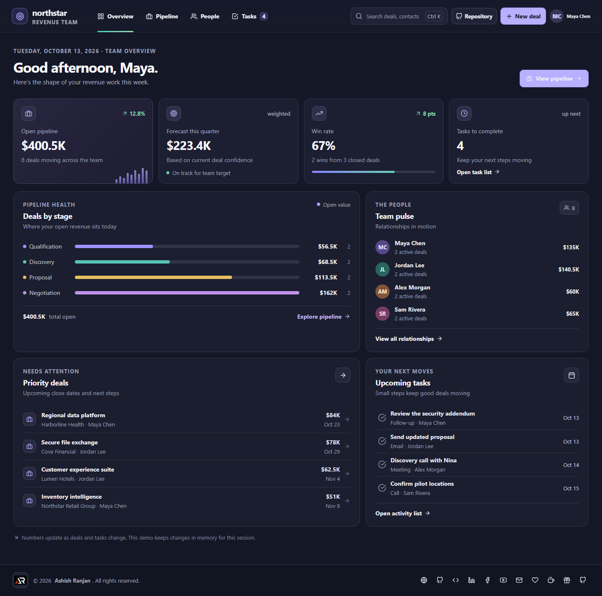 |
| Pipeline - stage board and deal actions | 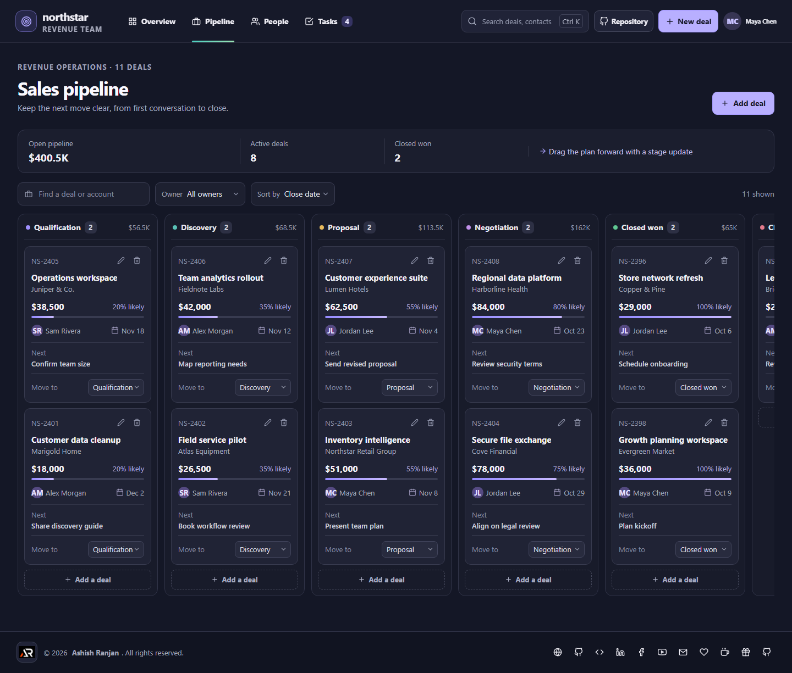 |
| People & accounts - searchable contact directory | 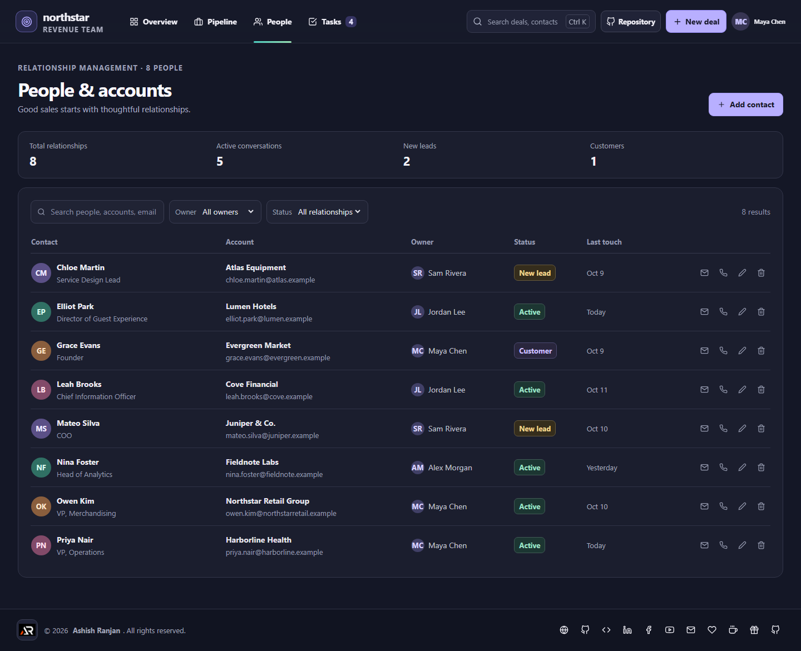 |
| Activities - follow-ups and task status | 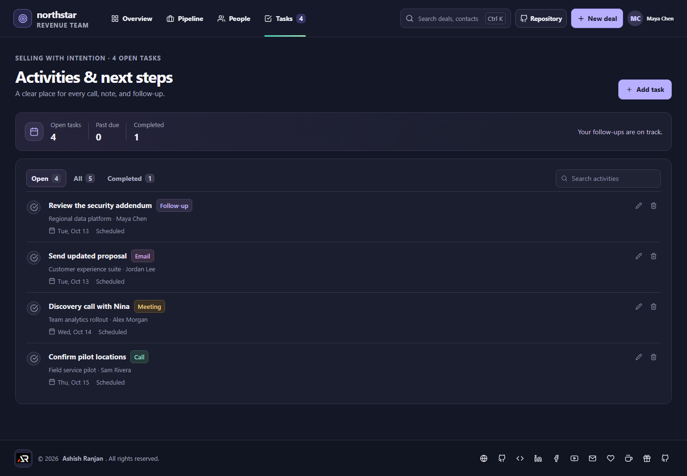 |
| Search - matching deals and contacts | 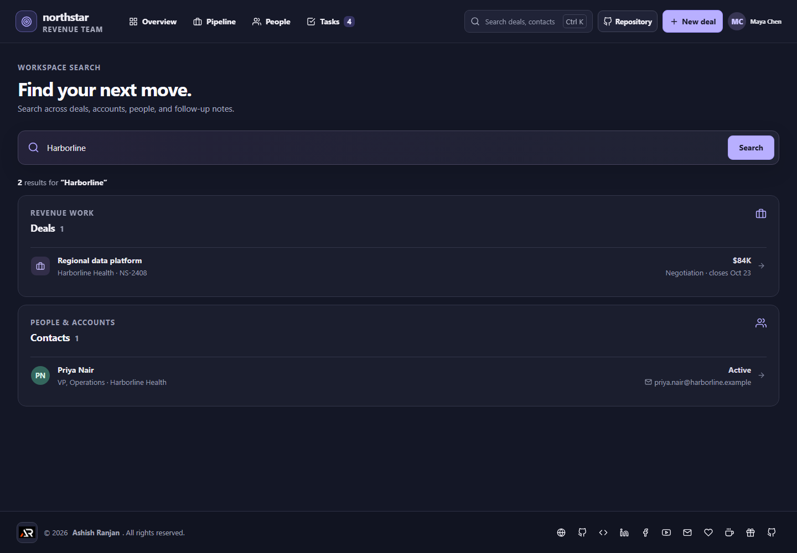 |

### Dialogs

| Dialog | Preview |
| --- | --- |
| Create a deal - validated opportunity form | 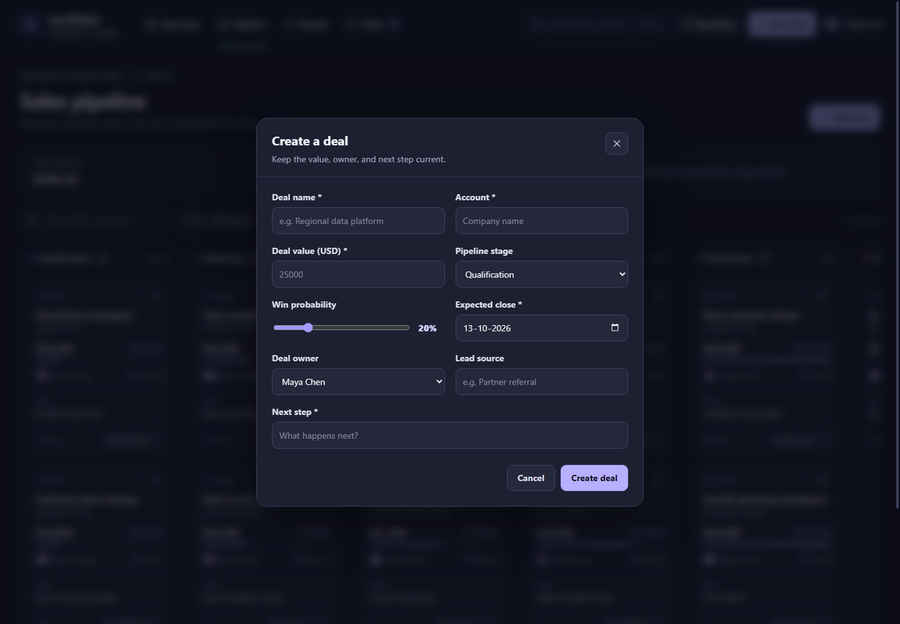 |
| Deal details - account, value, owner, and next step | 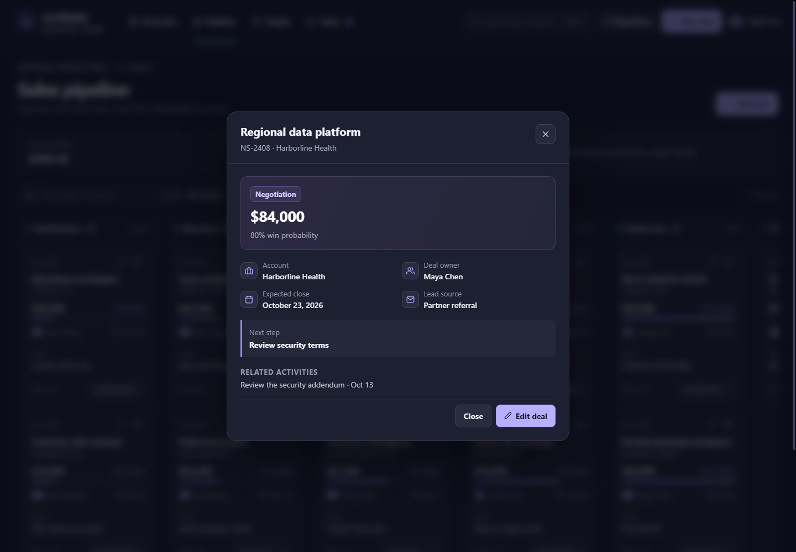 |
| Add a contact - relationship form | 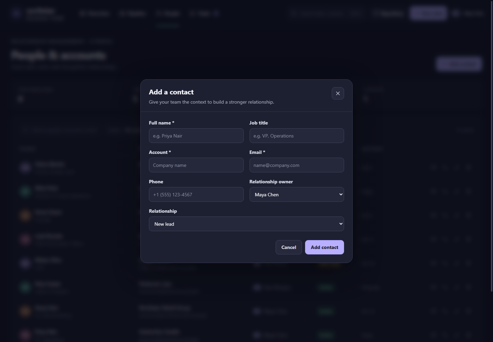 |
| Contact details - account and direct contact methods | 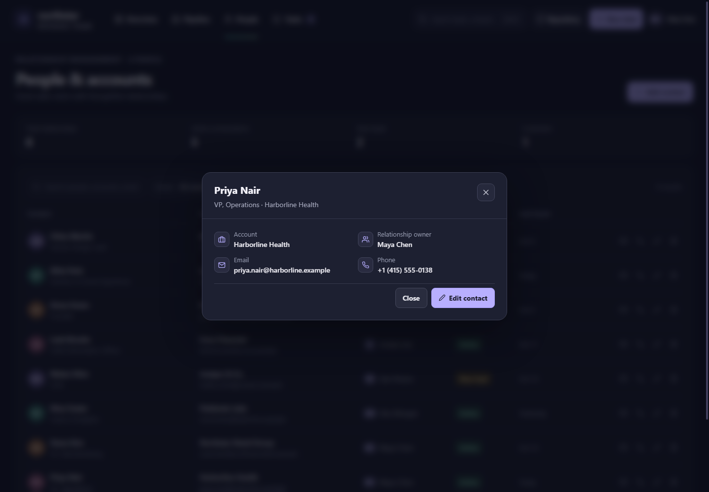 |
| Add an activity - task and optional deal link | 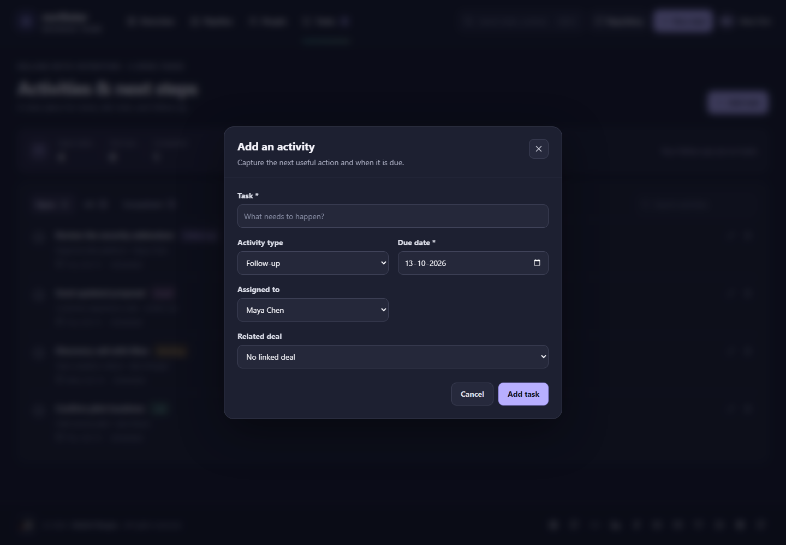 |
| Confirm removal - custom destructive-action dialog | 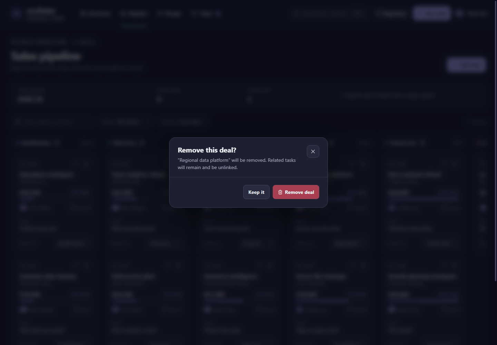 |

## Run locally

Requirements: Node.js and npm.

```bash
npm install
npm run dev
```

Then open the local URL printed by Vite.

## Checks and deploy

```bash
npm run lint
npm run build
npm run deploy
```

The deploy script builds the app, creates the GitHub Pages `404.html` fallback, and publishes the `dist` folder to the `gh-pages` branch. The project uses the `/crm-sales-pipeline/` base path for GitHub Pages.

## Future improvements

These are server-backed extensions and are not implemented in this demo:

- Add team accounts, permissions, and shared server storage so pipeline changes persist between sessions and users.
- Connect calendar and email services for scheduled meetings, reminders, and a verified activity history.
- Add server-side audit history for deal and relationship changes.
- Add authenticated reporting across historical pipeline and win-rate data.

## Links

- Portfolio: [https://www.ashishranjan.net](https://www.ashishranjan.net)
- GitHub: [https://github.com/a2rp](https://github.com/a2rp)
- CodePen: [https://codepen.io/ash1198](https://codepen.io/ash1198)
- LinkedIn: [https://www.linkedin.com/in/aashishranjan](https://www.linkedin.com/in/aashishranjan)
- Facebook: [https://www.facebook.com/theash.ashish/](https://www.facebook.com/theash.ashish/)
- YouTube: [https://www.youtube.com/@ashishranjan-ashz?sub_confirmation=1](https://www.youtube.com/@ashishranjan-ashz?sub_confirmation=1)
- Email: [mailto:ash.ranjan09@gmail.com](mailto:ash.ranjan09@gmail.com)

## Support

- Support: [https://a2rp-donation-page.netlify.app/](https://a2rp-donation-page.netlify.app/)
- Buy Me a Coffee: [https://buymeacoffee.com/ashishranjan](https://buymeacoffee.com/ashishranjan)
- Patreon: [https://www.patreon.com/ashishranjan](https://www.patreon.com/ashishranjan)
